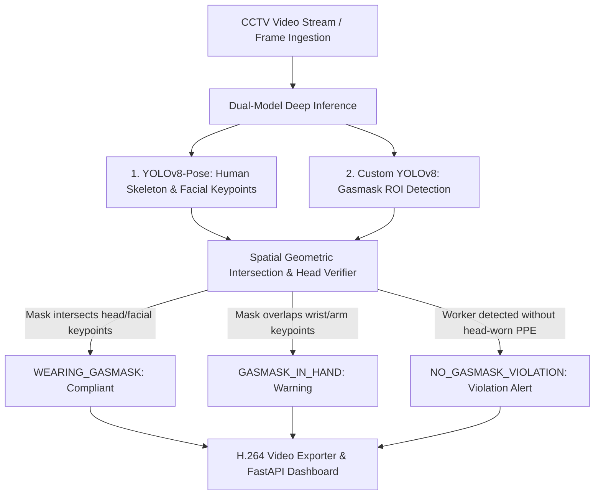

# 🤿 Industrial Safety Vision AI · Gasmask & Head-Worn PPE Verification

[](https://python.org)
[](https://fastapi.tiangolo.com)
[](https://ultralytics.com)
[](https://pytorch.org)
[](https://opencv.org)
[](LICENSE)

An automated industrial safety computer vision system designed for hazardous chemical and gas industrial complexes. Leverages **Dual-Model Deep Inference** (Human Pose Keypoints + PPE Gasmask Detection) and spatial geometric heuristics to ensure gasmasks are **properly worn on the head and face**, distinguishing compliant wear from masks carried by hand or sitting idle.

---

## 📑 Table of Contents
- [Problem & Industrial Solution](#-problem--industrial-solution)
- [Spatial Verification Rules](#-spatial-verification-rules)
- [System Architecture](#-system-architecture)
- [Core Features](#-core-features)
- [API Documentation](#-api-documentation)
- [Installation & Quickstart](#-installation--quickstart)
- [Contact](#-contact)

---

## 🎯 Problem & Industrial Solution

In hazardous chemical plants, standard object detection models frequently report false positives: a worker holding a gasmask in their hand or hanging it around their neck is incorrectly flagged as *"wearing PPE"*.

This system implements **Spatial Head-Worn Verification**:
* Combines worker body keypoints (eyes, nose, ears, shoulders) with a fine-tuned gasmask bounding box.
* Compliant safety status (`WEARING_GASMASK`) is granted **only if the mask geometrically intersects the worker's facial anatomy**.

---

## ⚖️ Spatial Verification Rules

| Safety State | Bounding Box | Classification | Safety Action |
|---|---|---|---|
| **Properly Head-Worn** | 🟩 Green Box | `WEARING_GASMASK` | ✅ Compliant (Safe) |
| **Carried in Hand** | 🟨 Yellow Box | `GASMASK_IN_HAND` | ⚠️ Non-compliant (Warning) |
| **Resting on Ground/Table**| ⬜ Gray Box | `ON_GROUND` | 📦 Unattended PPE (Ignored) |
| **Worker Without Gasmask** | 🟥 Red Box | `NO_GASMASK_VIOLATION` | 🚨 Hazard Alert (Violation) |

---

## 🏗 System Architecture



---

## 🌟 Core Features

* **Long-Distance Detection (15–30m):** High-resolution inference (`imgsz=1280`) resolves distant workers and small facial features across expansive industrial yards.
* **Camera Distance Estimation:** Estimates worker distance in meters (`Close <5m`, `Medium 5-15m`, `Distant >15m`) based on calibrated camera geometry.
* **Hardware Acceleration (NVIDIA CUDA):** Executes at 100+ FPS in FP16 precision on modern GPUs.
* **Interactive Web Dashboard:** Features drag-and-drop video upload, real-time progress tracking, and in-browser playback of annotated H.264 video.

---

## 🚀 API Documentation (FastAPI)

Swagger UI documentation is available at: `http://localhost:8000/docs`

| HTTP Method | Endpoint | Description |
|---|---|---|
| `POST` | `/api/video/analyze` | Upload video file, process frame-by-frame, and stream annotated H.264 MP4 |
| `POST` | `/api/image/analyze` | Inspect single image for PPE compliance |
| `GET` | `/api/status` | Retrieve system, GPU telemetry, and loaded model metadata |
| `GET` | `/` | Web GUI Dashboard |

---

## 💻 Installation & Quickstart

### 1. Clone the Repository:
```bash
git clone https://github.com/quvonchbek212/industrial-safety-vision-ai.git
cd industrial-safety-vision-ai
```

### 2. Environment Setup:
```bash
python -m venv .venv
source .venv/bin/activate  # Windows: .venv\Scriptsctivate
pip install -r requirements.txt
```

### 3. Launch the Server:
* **Windows:**
  ```cmd
  run.bat
  # or
  python main.py
  ```
* **Linux:**
  ```bash
  chmod +x run.sh
  ./run.sh
  ```

---

## 📬 Contact

* **Author:** Quvonchbek Begimqulov
* **LinkedIn:** [linkedin.com/in/quvonchbek212](https://www.linkedin.com/in/quvonchbek212/)
* **Email:** [begimqulovquvonchbek53@gmail.com](mailto:begimqulovquvonchbek53@gmail.com)
* **GitHub:** [@quvonchbek212](https://github.com/quvonchbek212)
