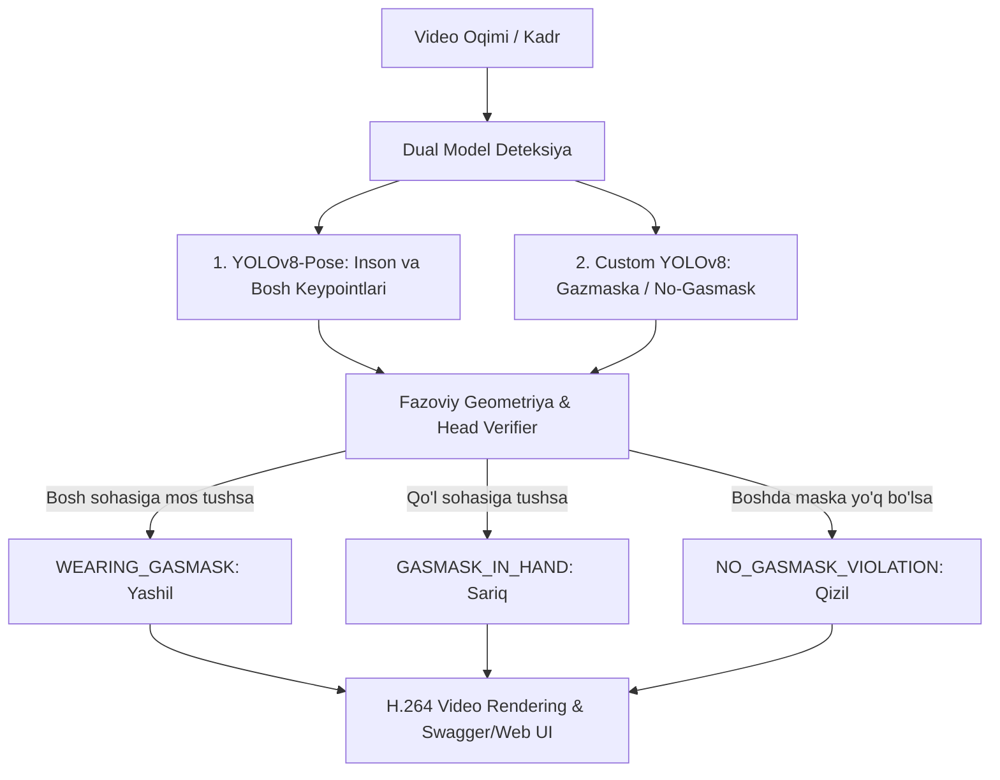

# 🤿 Gasmask & Head-Worn Verification AI System

[](https://python.org)
[](https://fastapi.tiangolo.com)
[](https://ultralytics.com)
[](https://pytorch.org)
[](https://opencv.org)
[](LICENSE)

Sanoat va xavfli ishlab chiqarish obyektlarida video hamda tasvirlarda ishchi xodimlarni va gazmaskalarni aniqlab, **faqat boshga to'g'ri taqilgan gazmaskalarni** avtomatlashtirilgan tarzda hisobga oluvchi yuqori aniqlikdagi Computer Vision & AI tizimi.

---

## 📑 Mundarija
- [Muammo va Yechim](#-muammo-va-yechim)
- [Bosh Algoritmi va Qoidalar](#-bosh-algoritmi-va-qoidalar)
- [Tizim Arxitekturasi](#-tizim-arxitekturasi)
- [Asosiy Xususiyatlar](#-asosiy-xususiyatlar)
- [API Hujjatlari](#-api-hujjatlari)
- [O'rnatish va Ishga Tushirish](#-ornatish-va-ishga-tushirish)
- [Loyiha Tuzilishi](#-loyiha-tuzilishi)
- [Bog'lanish](#-boglanish)

---

## 🎯 Muammo va Yechim

Ko'plab kimyoviy va gaz xavfi mavjud korxonalarda ishchilar gazmaskani shunchaki qo'lida ushlab yurishadi yoki bo'yniga osib olishadi. Oddiy detektorlar gazmaskani kadrda ko'rishi bilanoq *"Xodim gazmaska taqqan"* deb xato hisobot beradi.

Ushbu tizim **Dual-Model Inference** (Odam pozasi + Gazmaska detektori) va fazoviy geometriya tekshiruvini qo'llaydi:
* Gazmaska kadrda bo'lishi yetarli emas — u **aynan bosh qismida, yuz va nafas yo'llarini to'liq to'sib turgan holda taqilgan bo'lishi shart**.

---

## ⚖️ Bosh Algoritmi va Qoidalar (Head-Worn Verification)

| Holat | Vizual Belgi | Tizim Bahosi | Xavfsizlik Statusi |
|---|---|---|---|
| **Boshda to'g'ri taqilgan** | 🟩 Yashil ramka | `WEARING_GASMASK` | ✅ Qoida buzilmagan |
| **Qo'lda ushlab turilgan** | 🟨 Sariq ramka | `GASMASK_IN_HAND` | ⚠️ Taqilmagan (Ogohlantirish) |
| **Yerda yoki stolda yotgan** | ⬜ Kulrang ramka | `ON_GROUND` | 📦 E'tiborga olinmaydi |
| **Gasmasksiz ishchi xodim** | 🟥 Qizil ramka | `NO_GASMASK_VIOLATION` | 🚨 Xavf signali (Qoidabuzarlik) |

---

## 🏗 Tizim Arxitekturasi



---

## 🌟 Asosiy Xususiyatlar

1. **Uzoq Masofadagi Ishchilarni Aniq Aniqlash:**
   * Yuqori ruxsatli tahlil (`imgsz=1280`) orqali 15–30 metr masofadagi kichik o'lchamdagi yuzlar ham aniq tanib olinadi.
   * Kamera geometriyasi asosida masofa metrda baholanadi (`Yaqin <5m`, `O'rta 5-15m`, `Uzoq >15m`).

2. **NVIDIA GPU Tezlanishi (RTX 5090 / CUDA):**
   * CUDA FP16 rejimida soniyasiga 100+ kadr (FPS) tezlikda real-vaqt rejimida video oqimini qayta ishlaydi.

3. **Veb Dashboard va Video Pleyer:**
   * Drag-and-drop orqali video yuklash, tahlil jarayonini progress-barda kuzatish va belgilangan natijaviy videoni to'g'ridan-to'g'ri brauzerda tomosha qilish imkoniyati.

---

## 🚀 API Hujjatlari (Endpoints)

FastAPI orqali Swagger UI: `http://localhost:8000/docs`

| Metod | Endpoint | Tavsif |
|---|---|---|
| `POST` | `/api/video/analyze` | Video yuklash, kadrma-kadr tahlil va natijaviy annotatsiyalangan H.264 videoni qaytarish |
| `POST` | `/api/image/analyze` | Bitta rasmda xodimlarning gazmaska taqqanligini tekshirish |
| `GET` | `/api/status` | Tizim, GPU va modellarning hozirgi holati |
| `GET` | `/` | Interaktiv Veb Dashboard |

---

## 💻 O'rnatish va Ishga Tushirish

### 1. Repozitoriyni klonlash:
```bash
git clone https://github.com/quvonchbek212/gasmask-detection-ai.git
cd gasmask-detection-ai
```

### 2. Muhitni tayyorlash:
```bash
python -m venv .venv
source .venv/bin/activate  # Windows: .venv\Scripts\activate
pip install -r requirements.txt
```

### 3. Serverni ishga tushirish:
* **Windows:**
  ```cmd
  run.bat
  # yoki
  python main.py
  ```
* **Linux:**
  ```bash
  chmod +x run.sh
  ./run.sh
  ```

---

## 📂 Loyiha Tuzilishi

```text
gasmask-detection-ai/
├── core/
│   ├── detector.py          # Dual-model (YOLOv8-Pose + exp-3.pt Gasmask)
│   ├── head_verifier.py     # Bosh, qo'l va yer fazoviy geometriya algoritmi
│   └── video_processor.py   # Kadrma-kadr tahlil, tracking va video rendering
├── models/
│   ├── exp-3.pt             # Fine-tuned qilingan maxsus gazmaska modeli
│   ├── expert.pt            # Fallback gazmaska modeli
│   └── yolov8n-pose.pt      # Inson pozasi va tana a'zolari detektori
├── static/
│   └── index.html           # Interaktiv veb dashboard
├── uploads/                 # Kiruvchi media fayllar
├── outputs/                 # Tahlil qilingan chiqish videolari
├── main.py                  # FastAPI ilovasi va marshrutlar
└── requirements.txt         # Kerakli Python kutubxonalari
```

---

## 📬 Bog'lanish

* **Muallif:** Quvonchbek Begimqulov
* **LinkedIn:** [linkedin.com/in/kuvonchbek-begimkulov](https://linkedin.com/in/kuvonchbek-begimkulov)
* **Email:** [begimqulovquvonchbek53@gmail.com](mailto:begimqulovquvonchbek53@gmail.com)
* **GitHub:** [@quvonchbek212](https://github.com/quvonchbek212)
